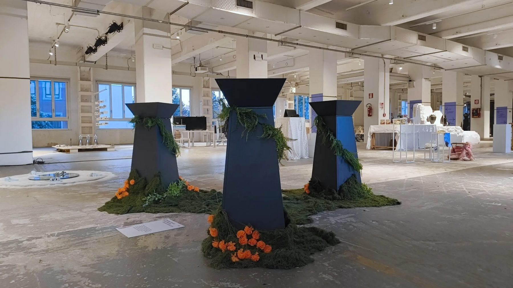
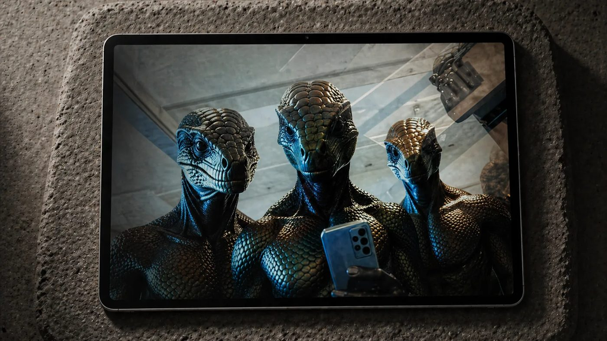
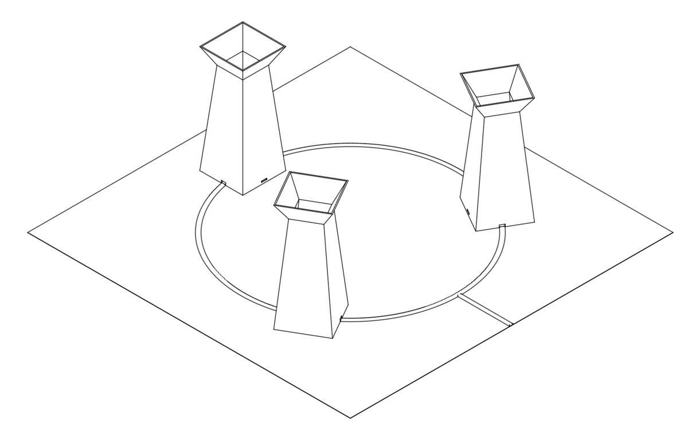

# Decart Realtime Starter

Build a realtime AI video mirror in an afternoon. Your camera goes in, Decart's Lucy models transform every frame, and the result streams back live.

A small, readable starter for web apps and installations, with the parts that matter in production already done. Secure client tokens, the camera tuned to the model, live prompt and reference-image changes, quality and latency readouts, and a cost meter.


## Quickstart

You need Node 20.12 or newer and a Decart API key from [platform.decart.ai](https://platform.decart.ai).

```bash
git clone https://github.com/olmedcr-cmyk/decart-realtime-starter.git
cd decart-realtime-starter
npm install
cp .env.example .env   # paste your DECART_API_KEY
npm run dev
```

Open the URL Vite prints, pick a model and a prompt, and press **Start mirror**.

## What you get

| | |
|---|---|
| **Four models in one UI** | Lucy 2.6 for live editing, Lucy 2.1 for character transformation, VTON for try-on, Restyle Live for styles |
| **Your key stays on the server** | Short-lived tokens locked to one model, one origin and a session cap, plus rate limiting |
| **Camera tuned to the model** | Exact fps and size, portrait or landscape, mirrored front camera |
| **Live control** | Debounced prompt updates and reference-image swaps without reconnecting |
| **Image quality controls** | 1080p request, codec choice, fast mode, browser-side reference resizing |
| **Readouts** | Connection quality and its limiting factor, camera-to-screen latency, output size and fps |
| **Cost meter and caps** | Billed seconds and estimated cost, stop at a limit, stop when the tab is hidden |
| **No framework** | Plain JavaScript with type checking against the SDK, one Vite config, a zero-dependency Node server |

## How it works

The core is twenty lines. Everything else in [`src/mirror.js`](src/mirror.js) is there to make it robust.

```js
import { createDecartClient, models } from "@decartai/sdk";

const model = models.realtime("lucy-latest"); // Lucy 2.6

const camera = await navigator.mediaDevices.getUserMedia({
  video: { facingMode: "user", frameRate: model.fps, width: model.width, height: model.height },
});

const client = createDecartClient({
  apiKeyProvider: async () => (await (await fetch("/api/realtime-token", { method: "POST" })).json()).apiKey,
});

const session = await client.realtime.connect(camera, {
  model,
  mirror: "auto",
  onRemoteStream: (stream) => (output.srcObject = stream),
  initialState: { prompt: { text: "Substitute the person with a humanoid jaguar.", enhance: true } },
});

session.setPrompt("Set the background to a bioluminescent jungle at night."); // live, no reconnect
```

### Your API key never reaches the browser


[`server/token.mjs`](server/token.mjs) mints a token right before each connect. It lives 60 seconds, opens one model, works from one origin and caps the session length. The same handler runs inside the Vite dev server and the production server.

### One session, from click to bill


## Models

| Model | Use it for | Reference image | Price |
|---|---|---|---|
| `lucy-latest` · Lucy 2.6 | Live editing. Characters, objects, backgrounds, styles | Optional | $0.02/s |
| `lucy-2.1` | Becoming a character from a face or character image | Character | $0.02/s |
| `lucy-vton-latest` · VTON 3.6 | Virtual try-on from a garment photo | Garment | $0.02/s |
| `lucy-restyle-latest` · Restyle Live | Restyling the whole scene | Style artwork | $0.01/s |

Billed per second of active generation at 720p. Fast mode doubles the price on the models that support it. Source and current prices at [docs.platform.decart.ai](https://docs.platform.decart.ai/getting-started/pricing).

## Ten rules for a better image

1. Light the face from the front. Backlight is the most common cause of a muddy result.
2. Capture at exactly the model's size and frame rate. The starter does it for you.
3. Send the prompt and image with the connect, so the first frame is already transformed.
4. Lead prompts with a verb. *Substitute*, *Add*, *Swap*, *Set the background*, *Restyle*.
5. Be concrete. "Add a silver crown floating above the person's head", not "make it royal".
6. No negatives. "Don't add a hat" tends to add a hat.
7. Use a clean reference. Front-facing, evenly lit, plain background, 512 to 2048 px.
8. Request `resolution: "1080p"` and check the output size in the HUD.
9. Prefer `h264` on phones and tablets for hardware decoding.
10. Test on the real network. Blocked UDP looks like a frozen video.

The full reasoning, with prompting, latency, cost and installation notes, is in **[docs/GUIDE.md](docs/GUIDE.md)**.

## Project structure

```
index.html            the mirror UI
src/mirror.js         the Decart session. Lift this into your own app
src/main.js           UI wiring
src/models.js         models, prices and example prompts
src/image.js          reference-image resizing in the browser
src/style.css
server/token.mjs      client-token endpoint, shared by dev and prod
server/index.mjs      production server. Static files plus the token endpoint
docs/GUIDE.md         implementation and quality guide
docs/anim/build.py    generates the animated diagrams
```

## Deploy

```bash
npm run build
npm start
```

`npm start` serves `dist/` and the token endpoint on `PORT` (default 8787). Run it on any Node host and set `DECART_API_KEY`, `ALLOWED_ORIGINS` (your public URL) and `MAX_SESSION_SECONDS`. Browsers only open the camera on HTTPS or localhost.

On a serverless platform, move `createRealtimeToken()` from `server/token.mjs` into a function and serve `dist/` as static files.

The token endpoint is open by design, which is right for a demo. Every token is capped in time and scope, but a script can still request them. For a product, put it behind your own sign-in or queue. More in [the guide](docs/GUIDE.md#03-keep-your-key-on-the-server).

## Scripts

| Command | What it does |
|---|---|
| `npm run dev` | Vite dev server with the token endpoint |
| `npm run build` | Production build into `dist/` |
| `npm start` | Production server |
| `npm run typecheck` | Type-checks all JavaScript against the SDK's types |
| `npm run anim` | Rebuilds the animated diagrams |

---

## Case study: Obsidian Reflections




Three fountains of black water at Base Milano, during Milan Design Week 2026. You leaned over one and Decart transformed your reflection in real time into a reptile, a quetzal or a jaguar, the three lives La Llorona lost in the Mexican legend.

Each pedestal held a tablet running a mirror like this one, with Lucy 2.1, a prompt and a reference image per animal. The piece was rewritten every night from what we saw during the day.

<table>
<tr>
<td width="60%"></td>
<td width="40%"></td>
</tr>
</table>

```
2,600   individual transformations
4,000+  people tried it
6       days, April 21 to 26, 2026
684     transformations in two hours at the peak
```

> "Decart is the only infrastructure I've found that becomes truly invisible. That is what lets the human experience take its rightful place."
> Cris Olmedo

What we learned there is folded into this starter and into [section 11 of the guide](docs/GUIDE.md#11-installations-and-kiosks).

---

## Credits

Made by **[Divina Machina](https://github.com/olmedcr-cmyk)** by Qs Ventures. Experience design by Cris Olmedo, Decart Brand & Creative Ambassador.

Built on [Decart](https://decart.ai) and [`@decartai/sdk`](https://www.npmjs.com/package/@decartai/sdk) 0.2.14. This is a community starter, not an official Decart product. Decart, Lucy and the Decart logo are marks of Decart.ai.

MIT licensed. See [LICENSE](LICENSE).
